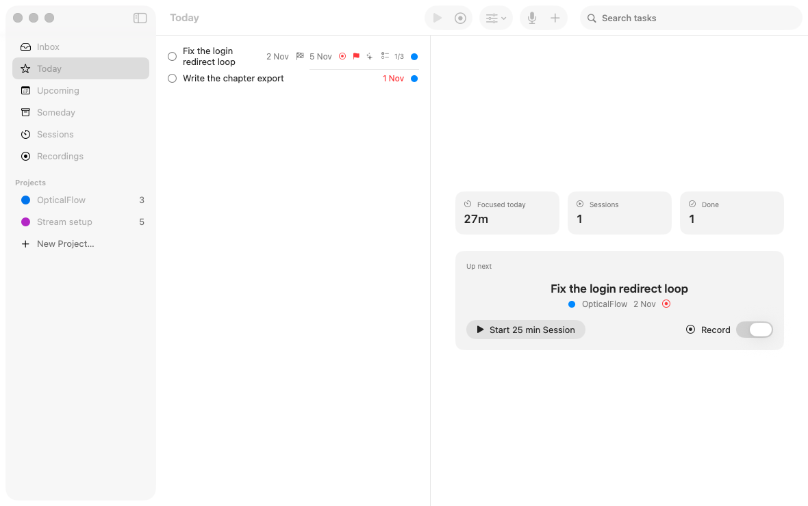

# OpticalFlow

A native macOS app for developers, vibe coders and streamers: pick a task, run a focus session on it, record the screen while you work, and export the recording with YouTube chapters made from what you finished. Tasks can be spoken, and a task can be handed to Claude Code or Codex to work on in its own git worktree.

Everything lives on your Mac. No account, no server, no telemetry.

[](https://github.com/Ahmad4041/OpticalFlow/actions/workflows/ci.yml)
[](LICENSE)


| Today | Board | Focus |
| --- | --- | --- |
|  |  |  |

## What it does

- **Tasks.** Inbox, Today, Upcoming, Someday and projects, keyboard first. Priority, subtasks, a planned day and a separate deadline, repeat rules, notes. Each project has a list and a kanban board (Backlog, To Do, Doing, Done).
- **Focus sessions.** A countdown on a task from the window, the menu bar, a floating mini timer, or the Touch Bar Control Strip. Pause, overtime, breaks, idle detection, a session log.
- **Recording.** Screen, system audio, microphone and camera through ScreenCaptureKit. Chapter markers while you record. Trim, camera bubble, follow the pointer, blur, YouTube preset on export. The chapter list comes from the tasks you completed and the markers you set.
- **Voice and AI.** Press Control-Option-Space and say "add fix the login loop to Fordan, due Friday, high priority". Clear commands run at once on-device. Compound requests go to Claude Code or Codex, installed on your Mac, which call the app's own CLI. Answers land on the task card while you keep working.
- **Hand a task to an agent.** Set a project's repository folder, choose Hand to Agent, and the app creates a branch and worktree, runs the agent with the task as its brief, then shows commits, diff size and cost on the card. Open a draft pull request or discard the branch. The app never merges.
- **CLI and MCP.** `opticalflow` drives the running app from any shell. The same binary is an MCP server for Claude Desktop.

## Requirements

- macOS 26 or later.
- Xcode 26 (Swift 6.2) to build. There is no Xcode project. It is a Swift package.
- Optional: [Claude Code](https://docs.claude.com/en/docs/claude-code) or [Codex CLI](https://github.com/openai/codex) for the AI orchestrator and hand-offs. [`gh`](https://cli.github.com) to open pull requests from the app.

## Install

```sh
git clone https://github.com/Ahmad4041/OpticalFlow.git
cd OpticalFlow
./build.sh --open
```

`build.sh` builds a release binary, signs it with your Apple Development certificate when you have one (ad hoc otherwise), stages the bundle under `~/Library/Developer/OpticalFlow/`, installs it to `~/Applications/OpticalFlow.app`, and links the CLI to `~/.local/bin/opticalflow`. Add `~/.local/bin` to your PATH if it is not.

macOS asks for Screen Recording the first time you record, Microphone and Speech Recognition the first time you use voice, and Camera when you turn the camera on. The app works without any of them.

## Use

| Action | Shortcut |
| --- | --- |
| New task | Command-N |
| Quick Entry from anywhere | Control-Space |
| Voice Command from anywhere | Control-Option-Space |
| Start or stop a session from anywhere | Control-Option-Command-S |
| Start or stop a session in the window | Command-Return |
| Pause or resume | Command-Option-P |
| Record the screen | Shift-Command-R |
| Mark a chapter while recording | Shift-Command-M (Control-Option-Command-M from anywhere) |
| Hand the task to an agent | Option-Command-H |
| List or board | Option-Command-B |
| Complete | Command-K |
| Due today | Command-T |

Every action is also a menu item. Settings has one tab per topic: Sessions (length, recording, Control Strip), Agent (orchestrator, microphone), Appearance (accent and light or dark).

### Voice and AI

Pick an orchestrator in Settings > Agent. Built-in understands dates, times, deadlines, repeats, priority, projects and subtasks in one sentence and never leaves the Mac. Claude Code and Codex handle anything else, with each command they run listed in the panel and on the toolbar sparkles while a job is in the background.

The built-in microphone on some MacBook Pro models delivers silence to apps. If the panel hears nothing, choose another microphone in Settings > Agent, or run `opticalflow agent listen --probe`.

### Hand a task to an agent

1. Right-click a project in the sidebar, Set Repository Folder, pick the git checkout.
2. On a task in that project, choose Hand to Agent.
3. The agent works on branch `opticalflow/<task id>` in a worktree under `~/Library/Application Support/OpticalFlow/worktrees/`. Your checkout is never touched. Runs stop at 80 turns or five dollars, and the agent may not push, merge or switch branches.
4. When it finishes the card shows the commit count and diff. The task detail has Open Pull Request, Reveal Worktree and Discard Branch.

### CLI and MCP

```sh
opticalflow status --json
opticalflow tasks add --title "Ship the release" --project Fordan --due fri --priority high --json
opticalflow agent say "move the login loop to doing" --json
opticalflow record mark --title "The bug appears" --json
opticalflow tasks handoff <id> --json
opticalflow help
```

For Claude Desktop or Claude Code:

```sh
claude mcp add --scope user opticalflow -- ~/Applications/OpticalFlow.app/Contents/MacOS/OpticalFlow mcp
```

The full command table is in [.claude/skills/opticalflow/SKILL.md](.claude/skills/opticalflow/SKILL.md).

## Privacy

Tasks, sessions and recordings are a SwiftData store and movie files under `~/Library/Application Support/OpticalFlow/`. Speech recognition runs on-device when macOS can, otherwise through Apple's speech service. Nothing is sent to Anthropic or OpenAI unless you choose Claude Code or Codex as the orchestrator and send a request or hand off a task. Those runs use your own CLI login and the app passes only the task title, notes and subtasks plus the commands' output.

## Layout

```
Sources/OpticalFlow/      the app: window, menus, views, recorder, exporter, voice, agent CLI
Sources/OpticalFlowKit/   rules with no UI: dates, repeats, priorities, voice intents, chapters
Tests/OpticalFlowKitTests unit tests for the Kit
tools/                    self-test, snapshots, grid lint, icon build
docs/                     brief, user stories, fix log, research, architecture reviews
.agents/skills/           the bama skills the app was built with (MIT, vendored)
```

See [ARCHITECTURE.md](ARCHITECTURE.md) for the shape, [docs/STORIES.md](docs/STORIES.md) for every feature as a user story with its acceptance checks, and [docs/FIXLOG.md](docs/FIXLOG.md) for the bugs and the rule each one left behind.

## Contributing

Read [CONTRIBUTING.md](CONTRIBUTING.md) for the workflow and [TESTING.md](TESTING.md) for the checks every change runs. Be kind: [CODE_OF_CONDUCT.md](CODE_OF_CONDUCT.md).

## Credits

Built with [bama](https://github.com/daveebbelaar/bama) agent skills (MIT), vendored under `.agents/skills/`. The Touch Bar Control Strip item uses the same private DFRFoundation calls as Pock and BetterTouchTool.

## License

[MIT](LICENSE).
